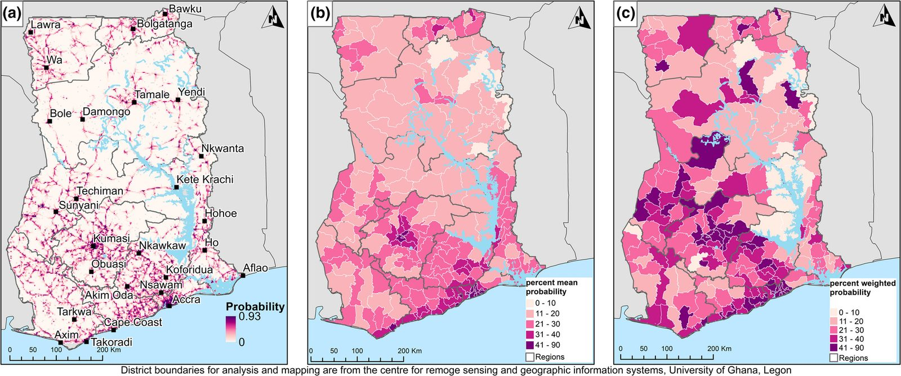

I am a Lecturer in Geographies of Health at University College London, specialising in spatial epidemiology and maternal health in low- and middle-income countries. My work sits at the intersection of public health, geospatial analysis, and social research, with a focus on generating actionable insights to improve health systems and outcomes.

Across academia and public health practice, I am committed to producing high-quality, policy-relevant research and supporting the next generation of scholars and practitioners in global health and geospatial data science.

{fig-alt="Three maps of Ghana showing modelled probability estimates, first as a fine-scale surface and then summarised by district."}

::: {.cv-row}
## Experience

```{=html}
<ul>
  <li><strong>Lecturer in Geographies of Health</strong><span class="current">Current</span><span class="sub">University College London</span></li>
  <li><strong>Lead, Geographies of Health research cluster</strong><span class="current">Current</span><span class="sub">University College London</span></li>
  <li><strong>Senior Research Fellow</strong><span class="sub">WorldPop, University of Southampton</span></li>
  <li><strong>Monitoring and Evaluation Lead</strong><span class="sub">Good Neighbors Ghana</span></li>
  <li><strong>Public Health Officer</strong><span class="sub">Kibi Government Hospital, Ghana</span></li>
  <li><strong>District Health Information Officer</strong><span class="sub">Atiwa District, Ghana</span></li>
</ul>
```
:::

::: {.cv-row}
## Education

```{=html}
<ul>
  <li><strong>PhD, Human Geography (Spatial Epidemiology)</strong><span class="sub">University of Southampton. Thesis: Spatial patterns of birthing care utilisation in Ghana</span></li>
  <li><strong>MSc, Applied GIS and Remote Sensing</strong><span class="sub">University of Southampton, Distinction</span></li>
  <li><strong>MSc, Social Research Methods</strong><span class="sub">University of Southampton, Distinction</span></li>
  <li><strong>BSc, Public Health</strong><span class="sub">University of Ghana, First Class Honours</span></li>
  <li><strong>Diploma, Health Information Management</strong><span class="sub">College of Health, Kintampo, Best Student</span></li>
  <li><strong>Postgraduate Certificate in Academic Practice</strong><span class="sub">Fellow of the Higher Education Academy</span></li>
</ul>
```
:::

::: {.cv-row}
## Research focus

```{=html}
<ul>
  <li>Spatial epidemiology</li>
  <li>Maternal, newborn, child and reproductive health</li>
  <li>Health systems in low- and middle-income countries</li>
  <li>GIS and remote sensing in public health</li>
  <li>Social research methods and health inequalities</li>
</ul>
```
:::

::: {.cv-row}
## Awards

```{=html}
<ul>
  <li><strong>South Coast DTP ESRC Impact Prize</strong><span class="sub">Winner</span></li>
  <li><strong>National ESRC Early Career Impact Prize</strong><span class="sub">Runner-up, UK</span></li>
  <li><strong>Doctoral College Director's Award for Engagement and Impact</strong></li>
  <li><strong>Commonwealth Scholarship</strong></li>
  <li><strong>ESRC 1+3 Scholarship</strong></li>
  <li><strong>Dean's List</strong><span class="sub">Four times</span></li>
</ul>
```
:::
