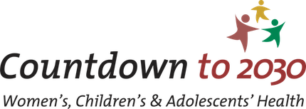

## Research approach

My work is grounded in the belief that better data leads to better health outcomes. By combining GIS and public health methods, I examine where and why inequalities in healthcare access exist, particularly for women and children. My research supports data-driven planning, helping decision-makers allocate resources more equitably and improve health service delivery.

My research sits at the crossroads of geographic data science and public health, with a particular interest in how location and distribution of quality health services influence health outcomes. I focus on:

```{=html}
<ul class="focus">
  <li><i class="fa-solid fa-car-side" aria-hidden="true"></i>Healthcare accessibility and utilisation</li>
  <li><i class="fa-solid fa-hands-holding-child" aria-hidden="true"></i>Maternal, newborn and child health</li>
  <li><i class="fa-solid fa-route" aria-hidden="true"></i>Spatial health inequalities</li>
  <li><i class="fa-solid fa-hospital-user" aria-hidden="true"></i>Routine health data systems</li>
  <li><i class="fa-solid fa-bacteria" aria-hidden="true"></i>Spatial epidemiology and disease mapping</li>
</ul>
```

## Current projects

```{=html}
<div class="projects">
  <div class="project">
    <div class="p-side"></div>
    <div><h3><a href="https://www.countdown2030.org/">Countdown to 2030</a></h3>
    <p>A multi-country effort working with health ministries and academic partners across more than 26 African nations. We use routine health facility data to track progress towards key health-related Sustainable Development Goals (SDGs).</p></div>
  </div>
  <div class="project">
    <div class="p-side">UKRI, Co-Investigator</div>
    <div><h3><a href="https://gtr.ukri.org/projects?ref=MR%2FZ505316%2F1">CONTAIN Project</a></h3>
    <p>I work alongside a cross-disciplinary team exploring new ways to understand and manage the spread of infectious diseases through spatial and social analysis.</p></div>
  </div>
  <div class="project">
    <div class="p-side">UCL Geography, Lead</div>
    <div><h3>Geographies of Health research cluster</h3>
    <p>A new cluster bringing together work on place, access and health inequalities.</p></div>
  </div>
  <div class="project">
    <div class="p-side">In development</div>
    <div><h3>FIND Study</h3>
    <p>Finding mother and child pairs who have dropped out of maternal and child health services in Ghana and Nigeria, so services can reach them again.</p></div>
  </div>
</div>
```

## Collaborations and impact

I regularly collaborate with government health agencies, NGOs, and international partners to turn research into real-world solutions. My work has informed health strategies across low- and middle-income countries, particularly in sub-Saharan Africa. My PhD, funded by the ESRC, was [recognised nationally](https://www.ukri.org/who-we-are/how-we-are-doing/research-outcomes-and-impact/esrc/improving-access-to-pregnancy-and-birth-services-in-ghana/) and [locally](https://southcoastdtp.ac.uk/news-post/the-scdtp-is-delighted-to-announce-the-winners-of-the-2020-21-and-2021-22-scdtp-impact-prizes-congratulations-to-all-winners/) for its impact on evidence-based policymaking and capacity development in Ghana.

The ESRC produced this video about my research impact in Ghana.

```{=html}
<div class="video"><iframe src="https://www.youtube-nocookie.com/embed/00Z3QJWFmho" title="ESRC video: improving access to pregnancy and birth services in Ghana" loading="lazy" allow="accelerometer; clipboard-write; encrypted-media; gyroscope; picture-in-picture" allowfullscreen></iframe></div>
```

## Publications {#publications}

```{=html}
<div class="filters" role="group" aria-label="Filter by theme">
  <button type="button" data-f="all" aria-pressed="true">All</button>
  <button type="button" data-f="access" aria-pressed="false">Access</button>
  <button type="button" data-f="maternal" aria-pressed="false">Maternal health</button>
  <button type="button" data-f="climate" aria-pressed="false">Climate</button>
  <button type="button" data-f="routine" aria-pressed="false">Routine data</button>
</div>
```

::: {#pubs}
:::

[[Full list on Google Scholar →](https://scholar.google.com/scholar?q=Dotse-Gborgbortsi)]{.more}

```{=html}
<script>
document.addEventListener("DOMContentLoaded", () => {
  const buttons = document.querySelectorAll(".filters button");
  const pubs = document.querySelectorAll(".pub");
  buttons.forEach((b) => {
    const f = b.dataset.f;
    const n = f === "all" ? pubs.length : [...pubs].filter((p) => p.dataset.themes.split(" ").includes(f)).length;
    b.insertAdjacentHTML("beforeend", ` <span class="n">${n}</span>`);
    b.addEventListener("click", () => {
      buttons.forEach((x) => x.setAttribute("aria-pressed", String(x === b)));
      pubs.forEach((p) => { p.hidden = f !== "all" && !p.dataset.themes.split(" ").includes(f); });
      document.querySelectorAll(".pub-group").forEach((g) => { g.hidden = !g.querySelector(".pub:not([hidden])"); });
    });
  });
});
</script>
```
