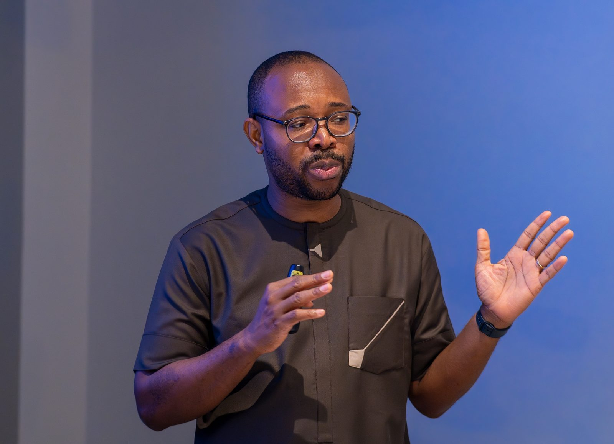

{fig-alt="Winfred speaking and gesturing during a talk."}

## Teaching approach

My teaching integrates geography, spatial data science, and public health. I emphasise practical skills, critical thinking, and real-world application to prepare students for research, policy, and practice.

```{=html}
<blockquote class="pullquote">
  <p>“Winfred has been an invaluable co-lead for our module for the last two years. His input has both broadened and deepened the content of the module, bringing unique insights from his work in Ghana, enriching the teaching by directly bringing his research into the education context. He teaches clearly and engages the students very effectively.”</p>
</blockquote>
```

## Current teaching at UCL

```{=html}
<ul class="courses">
  <li><span class="code">GEOG0194</span><div><strong>Health GIS</strong><div class="c-d">Mapping and spatial analysis for health questions.</div></div></li>
  <li><span class="code">GEOG0195</span><div><strong>Geography and Health</strong><div class="c-d">How place shapes health and access to care. Students write a policy brief as their final coursework.</div></div></li>
  <li><span class="code">POLS0010</span><div><strong>Data Analysis</strong><div class="c-d">Lectures on quantitative data analysis.</div></div></li>
</ul>
```

I also teach across these areas, helping students build strong spatial analysis skills alongside core geographical knowledge and methods:

```{=html}
<ul class="chips">
  <li>Geographic data science</li>
  <li>Foundations of Geography</li>
  <li>Health geography</li>
  <li>Geographic data science for public health</li>
</ul>
```

## Teaching and mentorship

I am committed to helping students and health professionals develop strong analytical, spatial, and conceptual skills, while mentoring emerging researchers in health and geographical sciences.

I have taught across undergraduate and postgraduate levels, with experience in:

-   Module leadership and curriculum design
-   Lectures, seminars, and GIS practicals
-   Designing applied, real-world assessments
-   Student feedback and academic support
-   Supervising dissertations (GIS, Remote Sensing, Applied Statistics)

I also supervise postgraduate and doctoral researchers in quantitative, spatial, and public health fields.

## Previous teaching at the University of Southampton, 2019 to 2025

::: {.cols-2}
::: {}
### GIS and spatial analysis

-   Core Skills in GIS
-   Introductory GIS
-   Advanced GIS
-   GIS for Health Analysis
:::

::: {}
### Public and population health

-   Health Services Organisation and Evaluation
-   Global and Population Health
-   Reproductive Health
:::
:::

## Training and capacity building

I have delivered international training and knowledge exchange programmes across Africa and the UK, focusing on:

```{=html}
<ul class="chips">
  <li>Data analysis in Stata, R and QGIS</li>
  <li>Routine health and survey data</li>
  <li>Health equity and spatial inequalities</li>
</ul>
```
